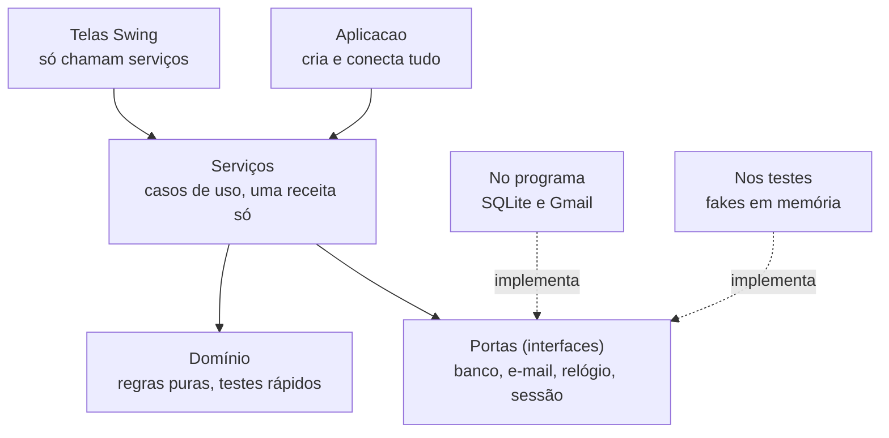

# Arquitetura e princípios de projeto

Gabriel Mallezan da Costa Ribeiro · decidido em 05/11/2026, antes da Etapa 3

Este documento registra como o código vai ser organizado e quais princípios guiam as decisões.
O critério principal foi a **velocidade do TDD**: cada ciclo Red → Green → Refactor precisa ser
curto, com testes que rodam em milissegundos e quase nenhuma preparação, sem retrabalho quando o
SQLite e a interface Swing entrarem. As classes e os métodos continuam os de
[`requisitos.md`](requisitos.md); aqui fica o *como*.

## 1. A decisão: camadas com portas e adaptadores, na versão enxuta

O domínio e os serviços ficam no centro, sem saber que existe banco, e-mail ou tela. Tudo o que
muda ou atrapalha um teste (banco, e-mail, relógio, sorteio do código e sessão do administrador)
fica atrás de uma interface, a **porta**. No programa, a porta é implementada pela versão real;
nos testes, por uma versão falsa e simples.



**Alternativas consideradas**

| Abordagem | Por que não |
| --- | --- |
| Clean Architecture completa (uma classe por caso de uso, objetos de entrada e saída, presenters) | Quase dobra o número de classes para os mesmos 81 métodos. Faz sentido com várias interfaces e equipes; aqui só atrasa |
| Serviços com JDBC direto (Transaction Script com DAO) | Mais rápido no primeiro dia, mas todo teste de serviço passaria a precisar de banco. O TDD fica lento e contraria o RNF04 |

## 2. Camadas e regra de dependência

As setas só apontam para dentro: quem está numa camada pode usar as de baixo, nunca o contrário.

| Camada | Pacote | O que tem | Pode depender de |
| --- | --- | --- | --- |
| Montagem | `br.edu.ifmt.biblioteca` | `Aplicacao`: cria os objetos reais, liga uns aos outros e abre a tela | tudo |
| Interface | `ui` | Telas Swing | `servico`, `dominio` (cria objetos de valor como `Cpf` e lê dados para mostrar), `excecao` |
| Casos de uso | `servico` | Os 6 serviços e a interface `ProvedorDeOperador` | `dominio`, `repositorio`, `verificacao` (só as interfaces), `excecao`, `java.time.Clock` |
| Domínio | `dominio` | Entidades, objetos de valor, calculadoras, enums e records | `excecao` e o Java padrão |
| Portas de dados | `repositorio` | Interfaces dos 5 repositórios e `Transacao` | `dominio` |
| Adaptador de dados | `repositorio.sqlite` | Repositórios JDBC e `ConexaoSqlite` | `repositorio`, `dominio`, JDBC |
| Verificação | `verificacao` | Interfaces `GeradorCodigo` e `CanalEnvio` e as versões reais | `dominio`, Jakarta Mail |
| Exceções | `excecao` | `BibliotecaException` e subclasses | nada |

Três regras de ouro:

1. **O domínio não importa nada de fora do Java padrão.** Nada de JDBC, Swing ou e-mail.
2. **Os serviços só conhecem interfaces nas bordas.** `EmprestimoService` recebe um
   `EmprestimoRepository`, nunca um `EmprestimoRepositorySqlite`.
3. **Só a `Aplicacao` conhece as implementações reais.** Ela fica fora da cobertura, junto com a
   tela, porque não tem regra: só monta peças.

## 3. Portas e implementações

| Porta | Pacote | No programa | Nos testes |
| --- | --- | --- | --- |
| `LivroRepository`, `UsuarioRepository`, `AdministradorRepository`, `EmprestimoRepository` | `repositorio` | `…RepositorySqlite` | `…RepositoryMemoria` |
| `AuditoriaRepository` (só `adicionar` e consultas) | `repositorio` | `AuditoriaRepositorySqlite` | `AuditoriaRepositoryMemoria` |
| `Transacao` | `repositorio` | `ConexaoSqlite`: confirma no fim ou desfaz tudo se der exceção | `TransacaoDireta`: só executa |
| `GeradorCodigo` | `verificacao` | `GeradorCodigoAleatorio` (`SecureRandom`) | `GeradorCodigoFixo`: sempre `123456` |
| `CanalEnvio` | `verificacao` | `EmailCanalEnvio` (Gmail) | `CanalEnvioFalso`: guarda as mensagens |
| `Clock` (do Java) | `java.time` | `Clock.systemUTC()` | `RelogioDeTeste`: hora parada que dá para avançar |
| `ProvedorDeOperador` | `servico` | `AcessoService` | `OperadorFixo` (sempre o mesmo administrador) e `SemSessao` (sempre lança `SessaoInvalidaException`) |

**Como os repositórios se parecem.** Um repositório por tipo de dado principal. O `Livro` é
gravado junto com os seus exemplares, e é o `LivroRepository` que acha um exemplar pelo tombo.
Buscar devolve `Optional`; um método `default` chamado `obter…` lança a exceção de "não
encontrado", para os serviços não repetirem esse `if`:

```java
public interface UsuarioRepository {
    void salvar(Usuario usuario);                 // inclui ou atualiza
    Optional<Usuario> buscarPorCpf(Cpf cpf);
    List<Usuario> listarTodos();

    default Usuario obter(Cpf cpf) {
        return buscarPorCpf(cpf).orElseThrow(() ->
                new RegistroNaoEncontradoException("Usuário não encontrado: " + cpf.mascarado()));
    }
}
```

**Como a transação se parece.** Duas formas de chamar, com e sem valor de retorno:

```java
public interface Transacao {
    void executar(Runnable operacao);
    <T> T executar(Supplier<T> operacao);
}
```

## 4. A receita dos métodos de serviço

Todo método de serviço que altera dados segue os mesmos passos, sempre nesta ordem. Assim cada
GREEN de serviço fica quase mecânico, e o teste sabe exatamente o que conferir.

1. **Sessão:** `acesso.operadorAtual()`. Sem sessão, nada muda e nada é registrado.
2. **Carregar:** `repositorio.obter(…)`, que já lança "não encontrado".
3. **Validar:** regras que dependem de mais de um objeto (limite de 3 empréstimos, por exemplo).
4. **Código:** quando a operação pede confirmação, `verificacao.validarCodigo(…)` vem por último
   entre as checagens.
5. **Mudar, salvar e auditar, dentro da transação.** A regra em si fica no objeto de domínio, e o
   objeto é sempre salvo, mesmo que a versão em memória não precise disso.

```java
public void banir(Cpf cpf, String motivo, LocalDate data) {
    Administrador operador = acesso.operadorAtual();
    transacao.executar(() -> {
        Usuario usuario = usuarios.obter(cpf);
        usuario.banir(motivo, data);
        usuarios.salvar(usuario);
        auditoria.registrar(operador, TipoAcao.USUARIO_BANIDO, cpf.mascarado(), cpf, motivo);
    });
}
```

**Por que as checagens e o código ficam fora da transação.** Quando o código digitado está
errado, o `VerificacaoService` grava `CODIGO_INCORRETO` na trilha e lança a exceção. Se isso
acontecesse dentro da transação, a exceção desfaria também esse registro de segurança. Então a
transação envolve só as mudanças, que já foram todas validadas antes.

**Por que sempre salvar.** O repositório em memória guarda a referência do objeto, então esquecer
o `salvar` passaria nos testes de unidade e só quebraria no SQLite. A receita evita esse erro, e
no passo 8 cada serviço ganha um teste de integração do caminho principal, já com SQLite, para
pegar o que escapar.

## 5. Princípios aplicados

### SOLID

| Princípio | Onde entra | O que acelera |
| --- | --- | --- |
| Responsabilidade única | Calculadoras de multa e suspensão fora do `Emprestimo`; `Cpf` e `Isbn` como objetos próprios; cada serviço cuida de um grupo de casos de uso | Testes pequenos, cada um falha por um motivo só |
| Aberto/fechado | `CanalEnvio` e `PoliticaCirculacao` | Um canal novo (WhatsApp) ou outro prazo entra sem mexer nos serviços. Não forçamos isso no resto |
| Substituição de Liskov | Repositório em memória e repositório SQLite | Testes de contrato (seção 6) garantem que os dois se comportam igual |
| Segregação de interfaces | Um repositório por tipo de dado; `AuditoriaRepository` sem alteração; `ProvedorDeOperador` com um método | O teste de `UsuarioService` não precisa simular entrada com código: usa `OperadorFixo` |
| Inversão de dependência | Serviços recebem interfaces pelo construtor | Só a `Aplicacao` conhece SQLite e Gmail |

### Padrões GoF

| Padrão | Onde entra | O que acelera |
| --- | --- | --- |
| Strategy | `GeradorCodigo`, `CanalEnvio` e `Clock` | Testes determinísticos: código conhecido, e-mail que não sai, hora controlada |
| Facade | Cada serviço é a porta de entrada da tela | A tela não monta regra nenhuma, e por isso pode ficar fora do TDD |
| Template Method | Testes de contrato dos repositórios: a classe abstrata tem os testes, as filhas só dizem qual repositório criar | O teste é escrito uma vez e roda nas duas versões |
| Builder | Dados de teste (`UmLivro`, `UmUsuario`, `UmAdministrador`) | Preparar um cenário leva uma ou duas linhas |
| State, versão leve | Enums `SituacaoLivro`, `SituacaoExemplar` e `SituacaoEmprestimo`, com as transições validadas na própria entidade (`registrarSaida`, `registrarRetorno`, `registrarExtravio`…) | A mesma segurança de uma máquina de estados, sem uma classe por estado |

### GRASP

| Princípio | Onde entra |
| --- | --- |
| Especialista na informação | A regra fica com quem tem o dado: `Emprestimo` calcula o atraso, `Livro` lista as pendências e conta os exemplares disponíveis, `Usuario` diz se pode emprestar, `CodigoVerificacao` se confere, `Sessao` sabe se expirou |
| Criador | `Livro` cria o `Exemplar` (é o único jeito de nascer um); `AuditoriaService` cria o `RegistroAuditoria`, porque conhece a última sequência e o último hash; a `Aplicacao` cria o resto |
| Controlador | Os serviços recebem os pedidos da tela; a tela nunca chama um método que altera o domínio |
| Baixo acoplamento | `EmprestimoService` usa `LivroRepository` e `UsuarioRepository` direto, em vez de depender de `AcervoService` e `UsuarioService` |
| Alta coesão | Cada classe de domínio cuida do próprio estado; as checagens que cruzam objetos ficam no serviço |
| Invenção pura | Repositórios, `Transacao`, gerador, canal e calculadoras não são conceitos de biblioteca; existem para manter as outras classes coesas |
| Indireção e variações protegidas | Interface em todo ponto que muda ou atrapalha o teste: banco, e-mail, relógio, sorteio e sessão |
| Polimorfismo | As versões real e falsa de cada porta, trocadas sem `if` |

## 6. Kit de testes

Fica em `src/test/java/br/edu/ifmt/biblioteca/`, e cada peça nasce no primeiro teste que precisar
dela, não antes.

| Peça | Pacote de teste | Para quê |
| --- | --- | --- |
| `…RepositoryMemoria` | `repositorio/memoria` | Repositórios com `HashMap`, usados nos testes de serviço |
| `…RepositoryContrato` | `repositorio` | Classe abstrata com os testes do repositório e um método `criarRepositorio()` |
| `…RepositoryMemoriaTest` e `…RepositorySqliteIT` | `repositorio/memoria` e `repositorio/sqlite` | Herdam o contrato; o primeiro roda no `test`, o segundo no `verify` |
| `…ServiceSqliteIT` | `servico` | Um teste do caminho principal de cada serviço com SQLite, para pegar um `salvar` esquecido |
| `TransacaoDireta` | `apoio` | Executa a operação sem transação nenhuma |
| `RelogioDeTeste` | `apoio` | `Clock` parado com `avancar(Duration)`: validade do código, intervalo de reenvio, sessão |
| `GeradorCodigoFixo` | `apoio` | Devolve sempre `123456` |
| `CanalEnvioFalso` | `apoio` | Guarda e-mail, assunto e mensagem de cada envio para o teste conferir |
| `OperadorFixo` e `SemSessao` | `apoio` | As duas situações de sessão que os serviços precisam testar |
| `UmLivro`, `UmUsuario`, `UmAdministrador` | `apoio` | Construtores de dados de teste, por exemplo `UmLivro.liberadoComExemplares(2)` |

Outras convenções:

- Nomes de teste no padrão `deve[Acao]Quando[Condicao]`, um comportamento por teste.
- `@ParameterizedTest` com `@CsvSource` para listas de entradas (CPFs, ISBNs, dias de atraso).
- Datas fixas e legíveis nos testes (`LocalDate.of(2026, 11, 10)`), nunca `now()`.
- Teste de serviço confere três coisas: o retorno, o que ficou gravado no repositório e o
  registro de auditoria.

## 7. Detalhes de implementação que poupam código

- **Records** para objetos de valor e tipos de apoio: `Cpf`, `Isbn`, `PoliticaCirculacao`,
  `DadosBibliograficos`, `ProcessamentoTecnico`, `FiltroAuditoria`, `ResultadoDevolucao`. O
  construtor compacto limpa e valida o valor, e `equals`, `hashCode` e `toString` vêm de graça.
- O `toString` de `Cpf` devolve a forma mascarada. Assim um CPF nunca vaza inteiro num log ou
  numa mensagem de erro por descuido (LGPD).
- Dinheiro sempre em `BigDecimal` com 2 casas; no SQLite, inteiro em centavos.
- Entidades (`Livro`, `Exemplar`, `Usuario`, `Administrador`, `Emprestimo`) são classes comuns,
  sem setters: o estado só muda pelos métodos de regra.

## 8. O que fica de fora, e por quê

| Fora | Motivo |
| --- | --- |
| Spring ou outro framework de injeção | Seis serviços cabem num construtor; a `Aplicacao` monta tudo em poucas linhas |
| ORM (Hibernate, JPA) | Cinco tabelas simples; JDBC direto é mais rápido de escrever e de entender |
| Mockito | Os fakes do kit são mais simples, e o teste confere o estado final em vez de chamadas |
| Observer ou eventos para a auditoria | Chamar `auditoria.registrar` explicitamente deixa claro o que é gravado e facilita o teste |
| Uma classe por estado (State completo) | Triplicaria as classes sem nenhum ganho de teste |
| Singleton | A `Aplicacao` cria uma única `ConexaoSqlite` e a passa adiante |
| Repositório genérico (`Repository<T, ID>`) | Cada repositório tem buscas próprias; a classe genérica só esconderia isso |
| Objetos intermediários entre tela e serviço | A tela recebe as entidades só para mostrar |

## 9. Ordem de construção

De dentro para fora, como na seção 12 dos requisitos. As peças do kit entram quando o primeiro
teste pede.

| Passo | Classes | Peças do kit que nascem aqui |
| --- | --- | --- |
| 1 | `Cpf`, `Isbn`, `CalculadoraMulta`, `CalculadoraSuspensao` | testes parametrizados |
| 2 | `Livro` e `Exemplar` | `UmLivro` |
| 3 | `Usuario` e `Administrador` | `UmUsuario`, `UmAdministrador` |
| 4 | `Emprestimo` | — |
| 5 | `CodigoVerificacao` e `GeradorCodigoAleatorio` | — |
| 6 | `Sessao`, `RegistroAuditoria`, `AuditoriaService`, `VerificacaoService`, `AcessoService` | `RelogioDeTeste`, `GeradorCodigoFixo`, `CanalEnvioFalso`, `TransacaoDireta`, repositórios em memória |
| 7 | `UsuarioService`, `AcervoService`, `EmprestimoService` | `OperadorFixo`, `SemSessao` |
| 8 | Repositórios SQLite, `ConexaoSqlite` e `EmailCanalEnvio` | testes de contrato e `…ServiceSqliteIT` |
| 9 | Telas Swing e `Aplicacao` | — |

## 10. O que mudou nos requisitos por causa desta decisão

- Os serviços recebem `ProvedorDeOperador` (implementado pelo `AcessoService`) em vez do
  `AcessoService` inteiro.
- O `EmprestimoService` usa `LivroRepository` e `UsuarioRepository` em vez de `AcervoService` e
  `UsuarioService`.
- Os serviços que alteram dados recebem `Transacao`.
- Repositórios ganham o padrão `buscar…` com `Optional` e `obter…` com exceção.
- Nos testes, entra o pacote `apoio`; no código, a classe `Aplicacao`, fora da cobertura.
