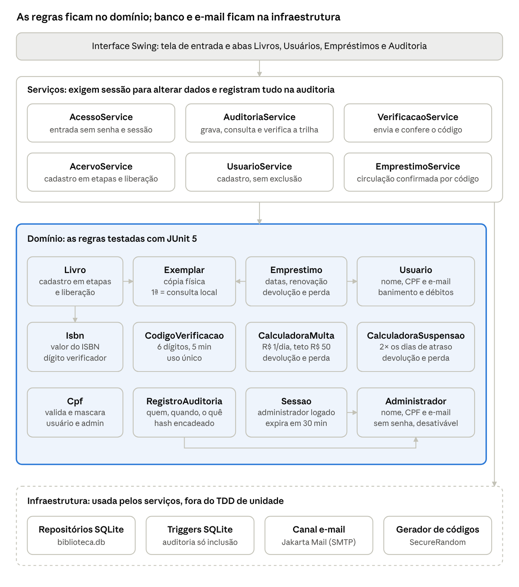

# Sistema de Biblioteca — Documento de Requisitos (Etapa 1 · TDD)

Gabriel Mallezan da Costa Ribeiro · atualizado em 05/11/2026

O sistema terá 12 classes de domínio, 6 serviços, 81 métodos testáveis e 33 regras de negócio. Ninguém usa senha: empréstimo, renovação e perda são confirmados por código no e-mail do usuário, e tudo o que os administradores fazem fica numa trilha de auditoria. Tudo isso está definido aqui antes de qualquer linha de código, para virar os testes da Etapa 3.

## 1. Identificação

| Item | Valor |
| --- | --- |
| Disciplina | Teste de Software — Atividade Prática TDD, Etapa 1 (Levantamento de Requisitos) |
| Instituição | IFMT |
| Grupo | Individual (1 integrante) |
| Contexto | Sistema de Biblioteca (acervo, usuários, circulação e auditoria) |
| Linguagem e interface | Java 17 com interface em Java Swing (telas simples) |
| Banco de dados | SQLite (um arquivo local) acessado por JDBC |
| Acesso sem senha | CPF + código de 6 dígitos enviado ao e-mail, por Jakarta Mail (SMTP) |
| Testes e build | JUnit 5, Maven e JaCoCo para cobertura |
| Versionamento | Git + GitHub: [GaeL-mdcr/biblioteca-tdd](https://github.com/GaeL-mdcr/biblioteca-tdd) |

## 2. Descrição do contexto

O sistema apoia os administradores de uma biblioteca escolar no controle do acervo e da circulação de livros. Cada livro é cadastrado em etapas (identificação, dados bibliográficos, processamento técnico e exemplares) e só entra em circulação quando um administrador o libera; o primeiro exemplar de cada livro é sempre de consulta local, então um livro com exemplar único só pode ser lido no local. Os usuários são cadastrados só com nome, CPF e e-mail e não têm senha: cada empréstimo, renovação ou registro de perda é confirmado com um código que chega ao e-mail deles. Todos pegam até 3 exemplares por 7 dias; quem atrasa paga multa e fica suspenso por um tempo, quem perde um livro paga a reposição ou repõe um exemplar igual, e em caso grave o usuário é banido para sempre. Os administradores também entram sem senha, com CPF e código, e tudo o que fazem fica registrado numa trilha de auditoria que não pode ser alterada.

## 3. Análise de sistemas de biblioteca

As regras deste projeto foram tiradas de sistemas e regulamentos reais: o software Koha, o Pergamum (usado em vários institutos federais) e regulamentos de bibliotecas, incluindo um do próprio IFMT. A tabela mostra o que cada um faz e o que foi adotado aqui.

| Referência | Como funciona lá | O que este projeto adota |
| --- | --- | --- |
| [Koha — regras de circulação](https://help.bywatersolutions.com/portal/en/kb/articles/circulation-and-fine-rule-matrix) | Cada categoria de usuário tem prazo, quantidade de empréstimos, multa por intervalo, carência, teto de multa, dias de suspensão e número de renovações | Prazo e limite únicos para todos; multa diária com teto; suspensão em dias; limite de renovações. Sem carência |
| [Regimento da Biblioteca do IFMT — Campus Avançado Lucas do Rio Verde](https://lrv.ifmt.edu.br/media/filer_public/7c/ce/7cce0357-bffd-4107-aa8a-4e434427b0c6/regimento_interno_biblioteca.pdf) | Docentes: 4 obras por 15 dias; discentes: 3 por 7 dias; técnicos: 3 por 10 dias. Um item por obra. Todo material tem um "item reserva" que não é emprestado, e itens únicos também não. 3 dias de suspensão por dia de atraso, contando fins de semana | O limite e o prazo dos discentes (3 obras por 7 dias), valendo para todos; um exemplar por livro por usuário; o primeiro exemplar como item de consulta local; contagem em dias corridos |
| [Regulamento da Biblioteca FacUnicamps](https://santahelena.facunicamps.edu.br/wp-content/uploads/2024/04/REGULAMENTO-DA-BIBLIOTECA.pdf) | O "livro de consulta" é o primeiro exemplar de cada título e edição e fica só para consulta local | Confirma a regra do primeiro exemplar |
| [Pergamum no IFMG Congonhas](https://plone.ifmg.edu.br/congonhas/biblioteca/regulamento_da_biblioteca.pdf) | Suspensão automática pelo dobro dos dias de atraso; usuário irregular não faz novos empréstimos; 1 exemplar por título | Suspensão de 2 dias por dia de atraso; bloqueio de usuário irregular |
| [Portaria 2149/2026 do IFG](https://www.ifg.edu.br/attachments/article/9286/PORTARIA%202149_REITORIA_IFG_DE%2029%20DE%20JANEIRO%20DE%202026.pdf) | Multa de R$ 1,00 por dia de atraso e por item; bloqueio de empréstimos ao acumular R$ 10,00 | Multa de R$ 1,00 por dia por exemplar; bloqueio com qualquer valor pendente (simplificação) |
| [Regulamento da Biblioteca FAMINAS Muriaé](https://www2.faminas.edu.br/wp-content/uploads/2024/04/Regulamento-Biblioteca-FAMINAS-Muriae-2024.pdf) | Usuários com atrasos recorrentes têm o acesso à biblioteca vetado | Base para o banimento permanente, aqui aplicado manualmente pelo bibliotecário |

Os valores numéricos (prazos, multa, teto, fator de suspensão) ficam em constantes ou parâmetros de construtor, para mudar sem mexer na lógica. O teto de R$ 50,00 por empréstimo é escolha deste projeto, inspirada no teto do Koha.

### Renovação e perda

| Referência | Como funciona lá | O que este projeto adota |
| --- | --- | --- |
| [Regimento do IFMT — Lucas do Rio Verde](https://lrv.ifmt.edu.br/media/filer_public/7c/ce/7cce0357-bffd-4107-aa8a-4e434427b0c6/regimento_interno_biblioteca.pdf) | Uma renovação por igual prazo, sem pendências. Em caso de perda, o usuário repõe um item igual em até 30 dias após a data prevista de devolução | Reposição física de exemplar igual em até 30 dias após o registro da perda |
| [Pergamum no IFMG Congonhas](https://plone.ifmg.edu.br/congonhas/biblioteca/regulamento_da_biblioteca.pdf) | Até 5 renovações seguidas, se a obra não estiver reservada e o usuário não estiver em atraso nem com pendências | Até 2 renovações, só com empréstimo em dia e usuário liberado |
| [Koha — custo de reposição](https://koha.bywatersolutions.com/education/monday-minutes-default-replacement-cost-per-item-type) | Cada item tem um custo de reposição; quando o item é marcado como perdido, esse valor é cobrado do usuário | Valor de reposição cadastrado em cada livro e cobrado no registro da perda |

### Verificação em duas etapas

Ninguém tem senha: a pessoa informa o CPF e confirma com um código de 6 dígitos que só chega a quem acessa o e-mail cadastrado. Isso vale para o administrador entrar no sistema e para o usuário confirmar empréstimo, renovação e perda.

| Opção | Como funciona | Custo | Decisão |
| --- | --- | --- | --- |
| E-mail com [Jakarta Mail e Gmail SMTP](https://support.google.com/accounts/answer/185833) | O sistema envia o e-mail por SMTP (smtp.gmail.com, porta 587) usando uma senha de app de 16 dígitos, que só existe em contas Google com verificação em 2 etapas ativada | Gratuito | Canal único: o cadastro guarda só nome, CPF e e-mail |
| WhatsApp pela [Cloud API oficial da Meta](https://developers.facebook.com/docs/whatsapp/cloud-api/get-started/) | O código vai num [template de autenticação](https://developers.facebook.com/documentation/business-messaging/whatsapp/templates/authentication-templates/authentication-templates/); o número de teste da Meta envia de graça para até 5 números cadastrados | Grátis no teste; em produção, cerca de US$ 0,007 por código no Brasil ([Authgear](https://www.authgear.com/post/whatsapp-api-pricing)) | Fora: exigiria guardar telefone |
| WhatsApp por bibliotecas não oficiais (Baileys, Evolution API) | Simulam o WhatsApp Web a partir de um QR code | Gratuito | Descartado: viola os termos do WhatsApp e o número pode ser banido sem recurso ([análise](https://pasqualepillitteri.it/en/news/12969/integrate-whatsapp-evolution-api-vs-cloud-api)) |

As regras do código seguem a [NIST SP 800-63B-4](https://pages.nist.gov/800-63-4/sp800-63b.html), norma dos EUA para autenticação: pelo menos 6 dígitos de um gerador aleatório seguro, validade de no máximo 10 minutos, uso único e limite de tentativas erradas, sem zerar a contagem quando um novo código é gerado. A mesma norma não aceita e-mail como segundo fator em sistemas federais dos EUA; numa biblioteca escolar o risco é aceitável, e em troca o sistema não guarda nenhuma senha.

### Cadastro em etapas

Nas bibliotecas, o livro passa pelo processamento técnico antes de chegar à estante. No [procedimento da Biblioteca do ICA/UFMG](https://www.ufmg.br/montesclaros/wp-content/uploads/2020/07/POP-BIB-3-Processamento-Tecnico-Recepcao-de-Material-1.pdf), o exemplar é tombado, carimbado e etiquetado, e só então marcado como disponível e liberado para o acervo; o exemplar de consulta local vai para a estante de novidades. Este projeto segue a mesma ideia: o livro nasce `EM_CADASTRO`, recebe dados bibliográficos, processamento técnico (classificação CDD, localização e valor de reposição) e exemplares, em qualquer ordem e em dias diferentes, e só circula depois de liberado.

### Trilha de auditoria

| Referência | O que diz | O que este projeto adota |
| --- | --- | --- |
| [OWASP Logging Cheat Sheet](https://cheatsheetseries.owasp.org/cheatsheets/Logging_Cheat_Sheet.html) | Registrar sucessos e falhas de autenticação, administração de usuários e alterações de dados, cada um com quando, onde, quem e o quê; nunca registrar senhas, tokens nem dados pessoais sensíveis; ter detecção de adulteração | Registro de toda alteração e de todo evento de acesso; o código de verificação nunca entra na trilha; CPF mascarado no texto; cadeia de hashes para detectar adulteração |
| [Koha — preferências de log](https://koha-community.org/manual/19.11/en/html/logspreferences.html) | Registra cadastro de leitores, catalogação, multas, empréstimos, devoluções, renovações e logins numa tabela `action_logs` | Uma tabela `auditoria` cobrindo as mesmas áreas |
| [LGPD, art. 37](https://www.aurum.com.br/blog/lgpd-comentada/art-37-a-40-lgpd) | Controlador e operador devem manter registro das operações de tratamento de dados pessoais que realizarem | Cadastro, alteração e banimento de usuários ficam registrados com quem fez e quando |
| [SQLite — CREATE TRIGGER](https://www.sqlite.org/lang_createtrigger.html) | `RAISE(ABORT, ...)` dentro de um trigger interrompe o comando e devolve erro | Triggers `BEFORE UPDATE` e `BEFORE DELETE` que impedem alterar ou apagar a auditoria direto no banco |

## 4. Escopo

O sistema cobre cadastro de livros em etapas, usuários, administradores sem senha, circulação confirmada por código, penalidades, banco de dados e trilha de auditoria; só a reserva de exemplares fica para depois.

**Dentro do escopo**

- Cadastro de livro em etapas (identificação, dados bibliográficos, processamento técnico, exemplares) e liberação para a biblioteca
- Consulta, edição e exclusão de livros; alteração do estado de conservação dos exemplares (novo, conservado, velho, danificado)
- Primeiro exemplar de cada livro reservado para consulta local
- Usuários cadastrados só com nome, CPF e e-mail, sem exclusão, com banimento permanente
- Administradores cadastrados com nome, CPF e e-mail, que entram sem senha (CPF + código no e-mail) e podem ser desativados
- Empréstimo, renovação e perda confirmados por código enviado ao e-mail do usuário
- Devolução, reposição física de exemplar perdido e pagamento de débitos
- Multa por atraso e suspensão temporária de empréstimos, com a mesma regra para todos
- Trilha de auditoria de tudo o que os administradores fazem e de todos os empréstimos de cada usuário
- Banco de dados SQLite
- Interface Swing simples

**Fora do escopo**

- Reserva de exemplares
- Tipos de usuário com limites diferentes: todos seguem a mesma regra
- Perfis de administrador com permissões diferentes: todo administrador pode tudo, e a auditoria mostra quem fez o quê
- Exemplar perdido dentro da biblioteca, sem empréstimo, e baixa de exemplar por desgaste
- Calendário de feriados e dias úteis
- Código por SMS ou WhatsApp e aplicativo autenticador (TOTP)
- Catálogo para o usuário consultar sozinho: só administradores usam o sistema

**Premissas**

- Prazos, atrasos e suspensões contam em dias corridos, como no regimento do IFMT
- As regras de circulação recebem a data como parâmetro (`LocalDate`); as que contam minutos (código, sessão e horário da auditoria) recebem um `Clock` no construtor. Nos testes os dois são fixados, então o resultado não depende de quando os testes rodam
- Valores em dinheiro usam `BigDecimal` com 2 casas decimais
- O código de verificação fica só em memória: nunca vai para o banco, para a auditoria, para log nem para a tela
- O usuário está no balcão: lê o código no próprio e-mail e o informa ao administrador
- Exemplar novo de um livro já liberado entra em circulação assim que é cadastrado

## 5. Requisitos funcionais

São 31 requisitos funcionais em 6 áreas; a última coluna aponta os métodos da seção 7 que os atendem.

| ID | Área | Requisito | Métodos |
| --- | --- | --- | --- |
| RF01 | Acervo | Iniciar o cadastro de um livro só com ISBN e título | M03, M04, M64 |
| RF02 | Acervo | Registrar os dados bibliográficos, podendo voltar e corrigir depois | M05, M65 |
| RF03 | Acervo | Registrar o processamento técnico: classificação, localização e valor de reposição | M06, M66 |
| RF04 | Acervo | Cadastrar exemplares com tombo e estado; o primeiro vira consulta local | M07, M67 |
| RF05 | Acervo | Mostrar as etapas que faltam em cada cadastro e listar os livros ainda em cadastro | M08, M70 |
| RF06 | Acervo | Liberar o livro para a biblioteca quando todas as etapas estiverem completas | M09, M69 |
| RF07 | Acervo | Pesquisar livros por título ou autor e buscar por ISBN | M70, M71 |
| RF08 | Acervo | Alterar o estado de conservação de um exemplar | M14, M68 |
| RF09 | Acervo | Excluir livro que nunca teve exemplar emprestado | M72 |
| RF10 | Acervo | Mostrar quantos exemplares de um livro estão disponíveis | M10, M11 |
| RF11 | Usuários | Cadastrar usuário com nome, CPF e e-mail | M01, M17, M59 |
| RF12 | Usuários | Consultar e atualizar nome e e-mail, sem opção de exclusão | M18, M60, M61 |
| RF13 | Usuários | Banir usuário para sempre, registrando o motivo | M19, M62 |
| RF14 | Usuários | Registrar pagamento de débito | M23, M63 |
| RF15 | Acesso | Cadastrar o primeiro administrador e, depois, outros administradores | M25, M47 |
| RF16 | Acesso | Desativar administrador, sem excluí-lo (fase 2) | M26, M48 |
| RF17 | Acesso | Entrar no sistema sem senha: CPF e código enviado ao e-mail | M41, M49, M50 |
| RF18 | Acesso | Encerrar a sessão pelo botão Sair; a expiração após 30 minutos sem uso é da fase 2 | M42, M43, M51, M52 |
| RF19 | Verificação | Enviar ao e-mail do usuário um código que descreve a operação a confirmar | M46, M57, M73 |
| RF20 | Verificação | Conferir o código antes de efetivar a operação | M38, M39, M40, M58 |
| RF21 | Circulação | Realizar empréstimo confirmado por código | M12, M24, M27, M74 |
| RF22 | Circulação | Renovar empréstimo confirmado por código | M31, M75 |
| RF23 | Circulação | Registrar devolução, sem código | M13, M30, M76 |
| RF24 | Circulação | Registrar perda confirmada por código, cobrando o atraso e o valor de reposição | M15, M32, M77 |
| RF25 | Circulação | Registrar a reposição física do exemplar perdido (fase 2) | M16, M33, M78 |
| RF26 | Circulação | Calcular multa e aplicar suspensão por atraso | M20, M21, M22, M29, M34, M35, M36, M37 |
| RF27 | Circulação | Listar empréstimos ativos, o histórico de cada usuário e os atrasados | M28, M79, M80, M81 |
| RF28 | Auditoria | Registrar na trilha toda alteração de dados e todo evento de acesso | M44, M53, M54 |
| RF29 | Auditoria | Consultar a trilha por administrador, usuário, ação e período | M55 |
| RF30 | Auditoria | Verificar se a trilha foi adulterada (fase 2) | M45, M56 |
| RF31 | Dados | Guardar tudo em SQLite, sem perder nada ao fechar o programa | Repositórios (seção 10) |

## 6. Classes principais e responsabilidades

As regras ficam em 12 classes de domínio que não dependem de tela nem de banco; 6 serviços coordenam as operações, exigem sessão de administrador para alterar dados e gravam tudo por meio de repositórios.



Um livro tem um ISBN e um ou mais exemplares; cada empréstimo liga um exemplar a um usuário, e cada registro de auditoria aponta o administrador que agiu. Os serviços recebem pelo construtor as calculadoras, o gerador de códigos, o canal de e-mail, o `Clock` e os repositórios, o que permite trocá-los por versões falsas nos testes.

| Classe | Camada | Responsabilidade | Principais atributos |
| --- | --- | --- | --- |
| `Cpf` | Domínio | Valida o CPF (11 dígitos e dígitos verificadores) e devolve a forma mascarada | `valor` |
| `Isbn` | Domínio | Valida o ISBN (10 ou 13 dígitos, com dígito verificador) | `valor` |
| `Livro` | Domínio | Guarda a obra e conduz o cadastro em etapas; diz o que falta e libera o livro para a biblioteca | `isbn`, `titulo`, `autor`, `editora`, `anoPublicacao`, `edicao`, `numeroPaginas`, `genero`, `classificacao`, `localizacao`, `valorReposicao`, `situacao`, `dataLiberacao`, `exemplares` |
| `Exemplar` | Domínio | Cópia física: estado de conservação, consulta local e situação; só circula se o livro estiver liberado | `codigoTombo`, `livro`, `estado`, `consultaLocal`, `situacao` |
| `Usuario` | Domínio | Leitor identificado pelo CPF, sem senha; guarda banimento, suspensão e saldo devedor | `cpf`, `nome`, `email`, `banido`, `motivoBanimento`, `dataBanimento`, `suspensoAte`, `saldoDevedor` |
| `Administrador` | Domínio | Pessoa que opera o sistema; entra sem senha e pode ser desativada, nunca excluída | `cpf`, `nome`, `email`, `ativo`, `dataDesativacao` |
| `Emprestimo` | Domínio | Saída de um exemplar para um usuário; calcula datas e atraso e controla renovação, devolução, perda e reposição | `usuario`, `exemplar`, `politica`, `dataEmprestimo`, `dataPrevistaDevolucao`, `dataDevolucao`, `situacao`, `quantidadeRenovacoes`, `dataPerda` |
| `CalculadoraMulta` | Domínio | Converte dias de atraso em valor de multa, respeitando o teto | `valorDiario`, `teto` |
| `CalculadoraSuspensao` | Domínio | Converte dias de atraso em dias de suspensão | `diasPorDiaDeAtraso` |
| `CodigoVerificacao` | Domínio | Código enviado por e-mail para uma finalidade: validade de 5 minutos, uso único e até 3 erros | `cpf`, `codigo`, `finalidade`, `emitidoEm`, `expiraEm`, `tentativasErradas`, `usado` |
| `Sessao` | Domínio | Período em que um administrador está conectado; expira depois de 30 minutos sem uso | `administrador`, `iniciadaEm`, `ultimoUsoEm` |
| `RegistroAuditoria` | Domínio | Um fato da trilha, imutável: quem, quando, o quê, alvo, usuário afetado, detalhes e hash encadeado ao anterior | `sequencia`, `dataHora`, `cpfOperador`, `acao`, `alvo`, `cpfUsuario`, `detalhes`, `hashAnterior`, `hash` |
| `GeradorCodigoAleatorio` | Segurança | Gera códigos de 6 dígitos com `SecureRandom` | `random` |
| `AcessoService` | Serviço | Cadastro e desativação de administradores, entrada sem senha e controle da sessão | `AdministradorRepository`, `VerificacaoService`, `AuditoriaService`, `Clock` |
| `AuditoriaService` | Serviço | Grava, consulta e verifica a integridade da trilha | `AuditoriaRepository`, `Clock` |
| `VerificacaoService` | Serviço | Gera, envia por e-mail e confere códigos; controla reenvio e bloqueio | `GeradorCodigo`, `CanalEnvio`, `AuditoriaService`, `Clock`, códigos ativos em memória |
| `UsuarioService` | Serviço | Cadastro, consulta, edição, banimento e pagamento; não tem exclusão | `UsuarioRepository`, `AcessoService`, `AuditoriaService` |
| `AcervoService` | Serviço | Cadastro em etapas, liberação, pesquisa e exclusão de livros; exemplares | `LivroRepository`, `EmprestimoRepository`, `AcessoService`, `AuditoriaService` |
| `EmprestimoService` | Serviço | Empréstimo, renovação, devolução, perda e reposição, pedindo código quando a regra exige | `EmprestimoRepository`, `AcervoService`, `UsuarioService`, `VerificacaoService`, `AcessoService`, `AuditoriaService`, calculadoras, `PoliticaCirculacao` |

**Tipos de apoio**

| Tipo | Valores ou contrato |
| --- | --- |
| `EstadoConservacao` (enum) | `NOVO`, `CONSERVADO`, `VELHO`, `DANIFICADO` |
| `SituacaoLivro` (enum) | `EM_CADASTRO`, `LIBERADO` |
| `EtapaCadastro` (enum) | `DADOS_BIBLIOGRAFICOS`, `PROCESSAMENTO_TECNICO`, `EXEMPLARES` |
| `SituacaoExemplar` (enum) | `DISPONIVEL`, `EMPRESTADO`, `EXTRAVIADO` |
| `SituacaoEmprestimo` (enum) | `ATIVO`, `DEVOLVIDO`, `PERDIDO`, `REPOSTO` |
| `Finalidade` (enum) | `ACESSO_ADMINISTRATIVO`, `EMPRESTIMO`, `RENOVACAO`, `PERDA` |
| `TipoAcao` (enum) | Operações: `LIVRO_INICIADO`, `LIVRO_DADOS_ALTERADOS`, `LIVRO_PROCESSAMENTO_ALTERADO`, `LIVRO_LIBERADO`, `LIVRO_EXCLUIDO`, `EXEMPLAR_CADASTRADO`, `EXEMPLAR_ESTADO_ALTERADO`, `USUARIO_CADASTRADO`, `USUARIO_ALTERADO`, `USUARIO_BANIDO`, `PAGAMENTO`, `EMPRESTIMO`, `RENOVACAO`, `DEVOLUCAO`, `PERDA`, `REPOSICAO`, `ADMINISTRADOR_CADASTRADO`, `ADMINISTRADOR_DESATIVADO`, `ENTRADA`, `SAIDA`. Segurança: `SESSAO_EXPIRADA`, `ACESSO_NEGADO`, `CODIGO_INCORRETO`, `VERIFICACAO_BLOQUEADA` |
| `PoliticaCirculacao` (record) | `limiteEmprestimos` = 3, `prazoDias` = 7, `maxRenovacoes` = 2, `prazoReposicaoDias` = 30 |
| `DadosBibliograficos` (record) | `titulo`, `autor`, `editora`, `anoPublicacao`, `edicao`, `numeroPaginas`, `genero` |
| `ProcessamentoTecnico` (record) | `classificacao`, `localizacao`, `valorReposicao` |
| `FiltroAuditoria` (record) | `cpfOperador`, `cpfUsuario`, `acao`, `de`, `ate` — qualquer campo pode ficar vazio |
| `ResultadoDevolucao` (record) | `diasAtraso`, `multa`, `valorReposicao`, `suspensoAte` — o que a tela mostra após devolução ou perda |
| `GeradorCodigo` (interface) | `String gerar()` — nos testes, um gerador fixo devolve sempre o mesmo código |
| `CanalEnvio` (interface) | `void enviar(String email, String assunto, String mensagem)` — implementada por `EmailCanalEnvio` (Jakarta Mail); nos testes, um canal falso só guarda a mensagem |
| Repositórios (interfaces) | `LivroRepository`, `UsuarioRepository`, `AdministradorRepository`, `EmprestimoRepository` e `AuditoriaRepository`, este só com `adicionar` e consultas. Cada um tem versão em memória (testes de unidade) e em SQLite (programa) |

**Exceções** (todas herdam de `BibliotecaException extends RuntimeException`, para a tela tratar num só `catch`): `CpfInvalidoException`, `IsbnInvalidoException`, `RegistroDuplicadoException`, `RegistroNaoEncontradoException`, `CadastroIncompletoException`, `ExemplarIndisponivelException`, `UsuarioBloqueadoException`, `EmprestimoNaoPermitidoException`, `LivroComEmprestimosException`, `RenovacaoNaoPermitidaException`, `ReposicaoNaoPermitidaException`, `CodigoVerificacaoInvalidoException`, `VerificacaoBloqueadaException`, `EnvioCodigoException`, `SessaoInvalidaException`, `OperacaoNaoAutorizadaException`. Dados inválidos usam `IllegalArgumentException` e operações fora de hora usam `IllegalStateException`, como no exemplo do enunciado.

## 7. Métodos por classe

São 81 métodos testáveis: 45 nas classes de domínio, 1 no gerador de códigos e 35 nos serviços. Getters, `listarTodos()`, `buscarExemplar(codigoTombo)` e os repositórios ficam fora da contagem; os repositórios SQLite têm testes de integração próprios (seção 10). IAE = `IllegalArgumentException`.

### Cpf

| ID | Assinatura | Comportamento esperado |
| --- | --- | --- |
| M01 | `Cpf(String valor)` | Remove pontos, traço e espaços. Exige 11 dígitos, não todos iguais, com os 2 dígitos verificadores corretos. `529.982.247-25` é válido; `529.982.247-24` e `111.111.111-11` lançam `CpfInvalidoException`. Dois `Cpf` de mesmo número são iguais (`equals`) |
| M02 | `String mascarado()` | Mostra só os 6 dígitos do meio: `529.982.247-25` → `***.982.247-**`. É a forma usada na tela e no texto da auditoria |

### Isbn

| ID | Assinatura | Comportamento esperado |
| --- | --- | --- |
| M03 | `Isbn(String valor)` | Remove hífens e espaços. Aceita 10 dígitos (o último pode ser `X`) ou 13 dígitos, com dígito verificador correto. `978-0-306-40615-7` e `0-306-40615-2` são válidos; `978-0-306-40615-8` lança `IsbnInvalidoException`. Dois `Isbn` de mesmo valor são iguais (`equals`) |

### Livro

| ID | Assinatura | Comportamento esperado |
| --- | --- | --- |
| M04 | `Livro(Isbn isbn, String titulo)` | Inicia o cadastro em `EM_CADASTRO`, sem exemplares. ISBN nulo ou título em branco → IAE |
| M05 | `void registrarDadosBibliograficos(DadosBibliograficos dados)` | Grava título, autor, editora, ano, edição, páginas e gênero. Título e autor são obrigatórios; ano, edição e páginas ≥ 1; editora e gênero são opcionais. Pode ser chamado de novo para corrigir, antes ou depois da liberação. Valor inválido → IAE, e nada muda |
| M06 | `void registrarProcessamentoTecnico(ProcessamentoTecnico dados)` | Grava classificação, localização e valor de reposição. Classificação no formato CDD, 3 dígitos com decimais opcionais (`869.3`); localização obrigatória (`Estante 4, prateleira B`); valor de reposição > 0. Violação → IAE |
| M07 | `Exemplar adicionarExemplar(String codigoTombo, EstadoConservacao estado)` | Cria o exemplar como `DISPONIVEL`. O primeiro do livro nasce com `consultaLocal = true`; os seguintes, com `false`. Tombo em branco ou estado nulo → IAE; tombo repetido no livro → `RegistroDuplicadoException` |
| M08 | `Set<EtapaCadastro> listarPendencias()` | Etapas ainda incompletas entre `DADOS_BIBLIOGRAFICOS`, `PROCESSAMENTO_TECNICO` e `EXEMPLARES`. Livro recém-iniciado → as três; tudo preenchido → conjunto vazio |
| M09 | `void liberar(LocalDate data)` | Muda para `LIBERADO` e guarda a data. Com pendências → `CadastroIncompletoException`, que lista as etapas que faltam; já liberado → `IllegalStateException` |
| M10 | `int contarExemplaresDisponiveis()` | Conta os exemplares com M11 verdadeiro. Livro em cadastro ou com exemplar único → 0 |

### Exemplar

Criado apenas por `Livro.adicionarExemplar` (M07).

| ID | Assinatura | Comportamento esperado |
| --- | --- | --- |
| M11 | `boolean podeSerEmprestado()` | `true` somente se o livro estiver `LIBERADO`, o exemplar `DISPONIVEL`, não for de consulta local e não estiver `DANIFICADO` |
| M12 | `void registrarSaida()` | Muda para `EMPRESTADO`. Se M11 for falso, lança `ExemplarIndisponivelException` com o motivo: livro em cadastro, consulta local, já emprestado, extraviado ou danificado |
| M13 | `void registrarRetorno(EstadoConservacao estadoNaDevolucao)` | Volta para `DISPONIVEL` e grava o estado informado. Exemplar que não está emprestado → `IllegalStateException`; estado nulo → IAE |
| M14 | `void atualizarEstado(EstadoConservacao novoEstado)` | Muda o estado de conservação. Estado nulo → IAE |
| M15 | `void registrarExtravio()` | Muda de `EMPRESTADO` para `EXTRAVIADO`, tirando o exemplar de circulação. Exemplar que não está emprestado → `IllegalStateException` |
| M16 | `void registrarReposicao()` | Muda de `EXTRAVIADO` para `DISPONIVEL` com estado `NOVO`, mantendo o tombo. Exemplar que não está extraviado → `IllegalStateException` |

### Usuario

| ID | Assinatura | Comportamento esperado |
| --- | --- | --- |
| M17 | `Usuario(Cpf cpf, String nome, String email)` | CPF, nome e e-mail são obrigatórios; o e-mail precisa ter `@` e um ponto depois dele. Violação → IAE. Começa sem banimento, sem suspensão e com saldo devedor R$ 0,00. Não existe campo de senha |
| M18 | `void atualizarDados(String nome, String email)` | Mesmas validações do construtor; o CPF não muda. Vale também para usuário banido |
| M19 | `void banir(String motivo, LocalDate data)` | Marca o usuário como banido e guarda motivo e data. Motivo em branco ou data nula → IAE; já banido → `IllegalStateException`. Não existe método para desfazer: `estaBanido()` fica verdadeiro para sempre |
| M20 | `void aplicarSuspensao(int dias, LocalDate aPartirDe)` | Dias ≤ 0 → IAE. Se o usuário já estiver suspenso em `aPartirDe`, os dias somam ao fim da suspensão atual; senão, contam a partir de `aPartirDe`. O resultado fica em `suspensoAte` |
| M21 | `boolean estaSuspenso(LocalDate data)` | `true` se `data` for anterior a `suspensoAte`. No próprio dia `suspensoAte` o usuário já pode emprestar |
| M22 | `void adicionarDebito(BigDecimal valor)` | Soma o valor (multa ou reposição) ao saldo devedor. Valor nulo ou negativo → IAE; zero não altera o saldo |
| M23 | `void abaterDebito(BigDecimal valor)` | Abate o valor do saldo, por pagamento ou reposição física. Valor ≤ 0 ou maior que o saldo → IAE |
| M24 | `void verificarPodeEmprestar(LocalDate data)` | Não faz nada se o usuário estiver liberado. Lança `UsuarioBloqueadoException` com o motivo se estiver banido, suspenso na data ou com saldo devedor maior que zero |

### Administrador

| ID | Assinatura | Comportamento esperado |
| --- | --- | --- |
| M25 | `Administrador(Cpf cpf, String nome, String email)` | Mesmas validações de `Usuario`; começa ativo. Não existe campo de senha |
| M26 | `void desativar(LocalDate data)` | Marca como inativo e guarda a data; inativo não consegue entrar no sistema. Já inativo → `IllegalStateException`. Não existe exclusão |

### Emprestimo

| ID | Assinatura | Comportamento esperado |
| --- | --- | --- |
| M27 | `Emprestimo(Usuario usuario, Exemplar exemplar, LocalDate dataEmprestimo, PoliticaCirculacao politica)` | Registra como `ATIVO` e calcula `dataPrevistaDevolucao` = data do empréstimo + 7 dias (prazo da política). 10/11 → 17/11. Argumento nulo → IAE |
| M28 | `boolean estaAtrasado(LocalDate data)` | `true` se está `ATIVO` e `data` é posterior à data prevista |
| M29 | `int calcularDiasAtraso(LocalDate data)` | Dias corridos entre a data prevista e `data`, nunca negativo. Prevista 17/11 e data 20/11 → 3; data 15/11 → 0 |
| M30 | `void registrarDevolucao(LocalDate dataDevolucao, EstadoConservacao estado)` | Grava a data, muda para `DEVOLVIDO` e chama `exemplar.registrarRetorno(estado)`. Data anterior ao empréstimo → IAE; empréstimo que não está `ATIVO` → `IllegalStateException` |
| M31 | `void renovar(LocalDate data)` | Nova data prevista = `data` + 7 dias, e soma 1 renovação. Empréstimo atrasado na data ou já com 2 renovações → `RenovacaoNaoPermitidaException`; não `ATIVO` → `IllegalStateException`; data anterior ao empréstimo → IAE |
| M32 | `void registrarPerda(LocalDate data)` | Muda para `PERDIDO`, grava a data da perda e chama `exemplar.registrarExtravio()`. Não `ATIVO` → `IllegalStateException`; data anterior ao empréstimo → IAE |
| M33 | `void registrarReposicao(LocalDate data)` | Muda de `PERDIDO` para `REPOSTO` e chama `exemplar.registrarReposicao()`. Mais de 30 dias depois da data da perda → `ReposicaoNaoPermitidaException`; não `PERDIDO` → `IllegalStateException` |

### CalculadoraMulta

| ID | Assinatura | Comportamento esperado |
| --- | --- | --- |
| M34 | `CalculadoraMulta(BigDecimal valorDiario, BigDecimal teto)` | Guarda os parâmetros; o construtor sem argumentos usa R$ 1,00 e R$ 50,00. Valor nulo ou ≤ 0, ou teto menor que o valor diário → IAE |
| M35 | `BigDecimal calcular(int diasAtraso)` | Retorna o menor entre dias × valor diário e o teto. 0 → R$ 0,00; 3 → R$ 3,00; 60 → R$ 50,00. Dias negativos → IAE |

### CalculadoraSuspensao

| ID | Assinatura | Comportamento esperado |
| --- | --- | --- |
| M36 | `CalculadoraSuspensao(int diasPorDiaDeAtraso)` | Guarda o fator; o construtor sem argumentos usa 2. Fator ≤ 0 → IAE |
| M37 | `int calcularDias(int diasAtraso)` | Retorna dias de atraso × fator. 0 → 0; 3 → 6. Dias negativos → IAE |

### CodigoVerificacao

| ID | Assinatura | Comportamento esperado |
| --- | --- | --- |
| M38 | `CodigoVerificacao(Cpf cpf, String codigo, Finalidade finalidade, Instant emitidoEm)` | Guarda o código e calcula `expiraEm` = emitidoEm + 5 minutos. Código sem exatamente 6 dígitos ou argumento nulo → IAE |
| M39 | `boolean estaExpirado(Instant agora)` | `true` a partir de `expiraEm`. Emitido às 10:00:00 → válido até 10:04:59, expirado às 10:05:00 |
| M40 | `void validar(String codigoDigitado, Finalidade finalidade, Instant agora)` | Código certo, da mesma finalidade e dentro da validade → marca como usado. Código errado ou de outra finalidade → soma 1 tentativa e lança `CodigoVerificacaoInvalidoException` com as tentativas restantes; na 3ª o código é invalidado. Expirado, já usado ou invalidado → `CodigoVerificacaoInvalidoException`, mesmo com o número certo |

### Sessao

| ID | Assinatura | Comportamento esperado |
| --- | --- | --- |
| M41 | `Sessao(Administrador administrador, Instant inicio)` | Abre a sessão com último uso igual ao início. Administrador inativo → `IllegalStateException` |
| M42 | `boolean estaExpirada(Instant agora)` | `true` quando passaram 30 minutos ou mais desde o último uso. Último uso às 10:00 → ativa às 10:29, expirada às 10:30 |
| M43 | `void registrarUso(Instant agora)` | Atualiza o último uso. Sessão expirada → `SessaoInvalidaException` |

### RegistroAuditoria

| ID | Assinatura | Comportamento esperado |
| --- | --- | --- |
| M44 | `RegistroAuditoria(long sequencia, Instant dataHora, Cpf cpfOperador, TipoAcao acao, String alvo, Cpf cpfUsuario, String detalhes, String hashAnterior)` | Cria o registro e calcula `hash` = SHA-256 de todos os campos mais `hashAnterior`. Data, ação e alvo são obrigatórios; o operador só pode faltar em ações de segurança; o primeiro registro usa `hashAnterior` com 64 zeros. Violação → IAE. Não há setters |
| M45 | `boolean hashConfere()` | Recalcula o hash com os campos atuais e compara com o guardado; `false` se algum campo foi mudado depois de gravado (por exemplo, direto no banco e depois relido pelo repositório, que remonta o registro com o hash guardado) |

### GeradorCodigoAleatorio

| ID | Assinatura | Comportamento esperado |
| --- | --- | --- |
| M46 | `String gerar()` | Retorna 6 dígitos de `SecureRandom.nextInt(1_000_000)`, com zeros à esquerda (ex.: `004271`). O teste confere o formato em 1.000 chamadas; a aleatoriedade em si não é testada |

Nos serviços, "exige sessão" quer dizer que o método chama `operadorAtual()` (M52) antes de mudar qualquer coisa: sem sessão válida, nada é alterado nem registrado. Cada alteração bem-sucedida grava um registro de auditoria com esse operador.

### AcessoService

| ID | Assinatura | Comportamento esperado |
| --- | --- | --- |
| M47 | `Administrador cadastrarAdministrador(Cpf cpf, String nome, String email)` | Sem nenhum administrador cadastrado, cria o primeiro sem pedir sessão. Depois disso, exige sessão. CPF já cadastrado → `RegistroDuplicadoException`. Registra `ADMINISTRADOR_CADASTRADO` |
| M48 | `void desativarAdministrador(Cpf cpf, LocalDate data)` | Exige sessão; aplica M26 e registra `ADMINISTRADOR_DESATIVADO`. Tentar desativar a si mesmo → `OperacaoNaoAutorizadaException` |
| M49 | `String solicitarAcesso(Cpf cpf)` | Se o CPF for de um administrador ativo, envia um código `ACESSO_ADMINISTRATIVO` (M57) e retorna o e-mail mascarado. CPF desconhecido ou inativo → `OperacaoNaoAutorizadaException`, com a mesma mensagem nos dois casos, e registra `ACESSO_NEGADO` |
| M50 | `Sessao entrar(Cpf cpf, String codigo)` | Confere o código (M58), abre a sessão (M41) e registra `ENTRADA`. Só existe uma sessão por vez: abrir outra encerra a anterior |
| M51 | `void sair()` | Registra `SAIDA` e encerra a sessão. Sem sessão aberta, não faz nada |
| M52 | `Administrador operadorAtual()` | Retorna quem está conectado e registra o uso (M43). Sem sessão → `SessaoInvalidaException`; sessão expirada → registra `SESSAO_EXPIRADA`, encerra a sessão e lança `SessaoInvalidaException` |

### AuditoriaService

| ID | Assinatura | Comportamento esperado |
| --- | --- | --- |
| M53 | `RegistroAuditoria registrar(Administrador operador, TipoAcao acao, String alvo, Cpf cpfUsuario, String detalhes)` | Cria o registro com a hora do `Clock`, sequência = última + 1 e `hashAnterior` = hash do último registro, e o grava (só inclusão). Operador nulo → IAE |
| M54 | `RegistroAuditoria registrarEventoSeguranca(TipoAcao acao, Cpf cpfEnvolvido, String detalhes)` | Igual a M53, mas sem operador, para eventos de quem ainda não entrou (código errado, acesso negado, bloqueio). Ação que não é de segurança → IAE |
| M55 | `List<RegistroAuditoria> consultar(FiltroAuditoria filtro)` | Registros que batem com todos os campos preenchidos do filtro (operador, usuário afetado, ação, período com datas inclusivas), do mais recente ao mais antigo. Filtro vazio → todos |
| M56 | `OptionalLong verificarIntegridade()` | Percorre a trilha em ordem e retorna a sequência do primeiro registro cujo hash não confere (M45) ou cujo `hashAnterior` não bate com o registro anterior. Trilha íntegra → vazio |

### VerificacaoService

| ID | Assinatura | Comportamento esperado |
| --- | --- | --- |
| M57 | `String enviarCodigo(Cpf cpf, String email, Finalidade finalidade, String descricaoOperacao)` | Gera um código novo (o anterior da pessoa deixa de valer) e o envia por e-mail com a descrição, ex.: "Código 482913 para confirmar o empréstimo de Dom Casmurro (tombo T-0002). Vale 5 minutos." Retorna o e-mail mascarado (`g*****l@gmail.com`). Pedido a menos de 60 s do último envio ou com verificação bloqueada → `VerificacaoBloqueadaException`; falha no envio → `EnvioCodigoException` |
| M58 | `void validarCodigo(Cpf cpf, Finalidade finalidade, String codigoDigitado)` | Confere com M40 usando o `Clock`. Acerto zera as falhas seguidas da pessoa. Cada erro soma uma falha e registra `CODIGO_INCORRETO` (M54); gerar código novo não zera a conta. Na 5ª falha seguida, bloqueia a verificação por 15 minutos e registra `VERIFICACAO_BLOQUEADA`. Sem código ativo → `CodigoVerificacaoInvalidoException` |

### UsuarioService

| ID | Assinatura | Comportamento esperado |
| --- | --- | --- |
| M59 | `Usuario cadastrar(Usuario usuario)` | Exige sessão. CPF já cadastrado → `RegistroDuplicadoException`. Grava e registra `USUARIO_CADASTRADO` |
| M60 | `Usuario buscarPorCpf(Cpf cpf)` | Retorna o usuário. Não encontrado → `RegistroNaoEncontradoException` |
| M61 | `void atualizarDados(Cpf cpf, String nome, String email)` | Exige sessão; aplica M18 e registra `USUARIO_ALTERADO` com os valores de antes e depois |
| M62 | `void banir(Cpf cpf, String motivo, LocalDate data)` | Exige sessão; aplica M19 e registra `USUARIO_BANIDO` com o motivo |
| M63 | `void registrarPagamento(Cpf cpf, BigDecimal valor)` | Exige sessão; aplica M23 e registra `PAGAMENTO` com o valor e o saldo restante |

### AcervoService

| ID | Assinatura | Comportamento esperado |
| --- | --- | --- |
| M64 | `Livro iniciarCadastro(Isbn isbn, String titulo)` | Exige sessão. ISBN já cadastrado → `RegistroDuplicadoException`. Cria o livro (M04) e registra `LIVRO_INICIADO` |
| M65 | `void registrarDadosBibliograficos(Isbn isbn, DadosBibliograficos dados)` | Exige sessão; aplica M05 e registra `LIVRO_DADOS_ALTERADOS` com os valores de antes e depois |
| M66 | `void registrarProcessamentoTecnico(Isbn isbn, ProcessamentoTecnico dados)` | Exige sessão; aplica M06 e registra `LIVRO_PROCESSAMENTO_ALTERADO` |
| M67 | `Exemplar cadastrarExemplar(Isbn isbn, String codigoTombo, EstadoConservacao estado)` | Exige sessão. Tombo já usado em qualquer livro do acervo → `RegistroDuplicadoException`. Aplica M07 e registra `EXEMPLAR_CADASTRADO` |
| M68 | `void alterarEstadoExemplar(String codigoTombo, EstadoConservacao estado)` | Exige sessão; aplica M14 e registra `EXEMPLAR_ESTADO_ALTERADO` com o estado anterior |
| M69 | `void liberarLivro(Isbn isbn, LocalDate data)` | Exige sessão; aplica M09 e registra `LIVRO_LIBERADO` |
| M70 | `List<Livro> pesquisar(String termo, SituacaoLivro situacao)` | Livros cujo título ou autor contém o termo, sem diferenciar maiúsculas, em ordem alfabética de título. Situação nula → todas; `pesquisar("", EM_CADASTRO)` lista os cadastros pendentes |
| M71 | `Livro buscarPorIsbn(Isbn isbn)` | Retorna o livro. Não encontrado → `RegistroNaoEncontradoException` |
| M72 | `void removerLivro(Isbn isbn)` | Exige sessão. Não encontrado → `RegistroNaoEncontradoException`; algum exemplar já teve empréstimo → `LivroComEmprestimosException`. Remove o livro e os exemplares e registra `LIVRO_EXCLUIDO` com os dados do livro |

### EmprestimoService

| ID | Assinatura | Comportamento esperado |
| --- | --- | --- |
| M73 | `String solicitarConfirmacao(Finalidade finalidade, Cpf cpf, String codigoTombo, LocalDate data)` | Para `EMPRESTIMO`, `RENOVACAO` ou `PERDA`: exige sessão e roda, sem alterar nada, as mesmas validações da operação. Na renovação e na perda, o CPF precisa ser o do usuário do empréstimo (senão `EmprestimoNaoPermitidoException`). Só então envia o código (M57) com a descrição da operação; na perda, a descrição traz o valor que será cobrado. Retorna o e-mail mascarado. `ACESSO_ADMINISTRATIVO` → IAE |
| M74 | `Emprestimo emprestar(Cpf cpf, String codigoTombo, String codigo, LocalDate data)` | Exige sessão e valida nesta ordem: usuário liberado (M24); sem empréstimo atrasado (senão `UsuarioBloqueadoException`); menos de 3 empréstimos ativos e nenhum exemplar do mesmo livro (senão `EmprestimoNaoPermitidoException`); exemplar disponível (M11). Por último confere o código (M58). Então registra a saída (M12), grava o empréstimo e registra `EMPRESTIMO` |
| M75 | `LocalDate renovar(Cpf cpf, String codigoTombo, String codigo, LocalDate data)` | Exige sessão. Acha o empréstimo ativo do exemplar (nenhum → `RegistroNaoEncontradoException`), confere que o CPF é do usuário dele, exige usuário liberado (M24) e testa M31. Por último confere o código; então renova, registra `RENOVACAO` e retorna a nova data prevista |
| M76 | `ResultadoDevolucao devolver(String codigoTombo, LocalDate data, EstadoConservacao estado)` | Exige sessão; não pede código. Acha o empréstimo ativo e registra a devolução (M30). Se houver atraso, soma a multa e aplica a suspensão a partir da devolução. Registra `DEVOLUCAO` com atraso, multa e suspensão. Aceita usuário banido ou suspenso |
| M77 | `ResultadoDevolucao registrarPerda(Cpf cpf, String codigoTombo, String codigo, LocalDate data)` | Exige sessão, confere que o CPF é do usuário do empréstimo e, por último, o código. Aplica M32, cobra multa e suspensão pelo atraso até a data e soma o valor de reposição ao saldo. Registra `PERDA`. Aceita usuário banido ou suspenso |
| M78 | `void registrarReposicao(String codigoTombo, LocalDate data)` | Exige sessão; não pede código. Acha o empréstimo perdido, aplica M33 e abate o valor de reposição do saldo (M23). Reposição já paga em dinheiro (saldo menor que o valor) → `ReposicaoNaoPermitidaException`. Registra `REPOSICAO` |
| M79 | `List<Emprestimo> listarAtivos(Cpf cpf)` | Empréstimos ativos do usuário. CPF não cadastrado → `RegistroNaoEncontradoException` |
| M80 | `List<Emprestimo> listarHistorico(Cpf cpf)` | Todos os empréstimos do usuário (ativos, devolvidos, perdidos e repostos), do mais recente ao mais antigo |
| M81 | `List<Emprestimo> listarAtrasados(LocalDate data)` | Todos os empréstimos ativos atrasados na data, do vencimento mais antigo ao mais recente |

## 8. Regras de negócio

São 33 regras, cada uma ligada aos métodos que a validam; toda regra vira pelo menos um teste de caminho feliz e um de violação.

| ID | Regra | Validada em | Base |
| --- | --- | --- | --- |
| RN01 | ISBN tem 10 ou 13 dígitos com dígito verificador válido | M03 | Padrão ISBN |
| RN02 | CPF tem 11 dígitos, não todos iguais, com os 2 dígitos verificadores corretos; identifica usuários e administradores e não muda | M01, M18 | Regra do CPF |
| RN03 | ISBN, tombo e CPF são únicos (o CPF, entre usuários e entre administradores) | M07, M47, M59, M64, M67 | Koha, Pergamum |
| RN04 | O livro é cadastrado em etapas, em qualquer ordem e em momentos diferentes; só é liberado com dados bibliográficos, processamento técnico e pelo menos um exemplar | M04, M08, M09, M69 | Processamento técnico (UFMG) |
| RN05 | Livro em cadastro não circula: nenhum exemplar dele pode ser emprestado | M10, M11, M12 | Processamento técnico (UFMG) |
| RN06 | Dados bibliográficos: título e autor são obrigatórios; ano, edição e páginas ≥ 1 | M05 | Escolha do projeto |
| RN07 | Processamento técnico: classificação no formato CDD, localização obrigatória e valor de reposição maior que zero | M06 | Koha, processamento técnico |
| RN08 | O primeiro exemplar cadastrado de cada livro é de consulta local e nunca é emprestado; livro com exemplar único só é lido na biblioteca | M07, M10, M11, M12 | IFMT, FacUnicamps |
| RN09 | Exemplar danificado ou extraviado não pode ser emprestado | M11, M12 | Escolha do projeto |
| RN10 | Livro só pode ser excluído se nenhum de seus exemplares já tiver sido emprestado | M72 | Integridade do banco |
| RN11 | Ninguém é excluído: o usuário pode ser banido para sempre, com motivo, e o administrador pode ser desativado. Banido não pega nem renova livros, mas pode devolver e ter perda registrada | M19, M24, M26, M62, M76, M77 | FAMINAS |
| RN12 | A mesma regra vale para todos: até 3 exemplares ao mesmo tempo, por 7 dias, e só um exemplar de cada livro | M27, M74 | IFMT (regra dos discentes) |
| RN13 | Novo empréstimo é bloqueado para usuário banido, suspenso, com débito pendente (multa ou reposição) ou com empréstimo atrasado | M24, M73, M74 | Pergamum, IFG |
| RN14 | Multa de R$ 1,00 por dia de atraso, por exemplar, com teto de R$ 50,00 por empréstimo; devolução até a data prevista não gera multa | M29, M35, M76, M77 | IFG, Koha |
| RN15 | Suspensão de 2 dias por dia de atraso, contada a partir da devolução ou da perda; se o usuário já estiver suspenso, os dias somam ao fim da suspensão atual | M20, M21, M37, M76, M77 | Pergamum |
| RN16 | Prazos, atrasos e suspensões contam em dias corridos | M20, M27, M29 | IFMT |
| RN17 | Pagamento ou abatimento de débito precisa ser maior que zero e no máximo igual ao saldo devedor | M23, M63 | Escolha do projeto |
| RN18 | A devolução não pode ter data anterior ao empréstimo e só acontece uma vez | M30 | Escolha do projeto |
| RN19 | Renovação só de empréstimo ativo e em dia, no máximo 2 vezes, com usuário liberado; a nova data prevista é a data da renovação + 7 dias | M31, M75 | IFMT, Pergamum |
| RN20 | Na perda, o empréstimo fica `PERDIDO` e o exemplar `EXTRAVIADO`, fora de circulação; o usuário recebe multa e suspensão pelo atraso até a comunicação, mais o valor de reposição do livro | M15, M32, M77 | Koha |
| RN21 | Em até 30 dias depois da perda, o usuário pode entregar um exemplar igual: ele volta como `NOVO` e o valor de reposição sai do saldo. Depois desse prazo, só pagamento | M16, M33, M78 | IFMT |
| RN22 | O sistema não guarda senha de ninguém. O administrador entra com CPF e código no e-mail; o usuário confirma empréstimo, renovação e perda com código no e-mail. Devolução, pagamento e reposição não pedem código, porque só reduzem obrigações do usuário | M49, M50, M73, M74, M75, M77 | NIST SP 800-63B |
| RN23 | O código tem 6 dígitos de um gerador aleatório seguro, vale 5 minutos e só pode ser usado uma vez, só para a finalidade em que foi emitido; um código novo invalida o anterior, e o e-mail descreve a operação que ele confirma | M38, M39, M40, M46, M57 | NIST SP 800-63B |
| RN24 | Cada código aceita até 3 tentativas erradas; 5 falhas seguidas bloqueiam a verificação da pessoa por 15 minutos, e gerar código novo não zera essa conta; um novo envio só sai 60 segundos depois do anterior | M40, M57, M58 | NIST SP 800-63B |
| RN25 | O código só é enviado depois que a operação passa nas demais regras e só é conferido por último, para não ser gasto numa operação recusada | M73, M74, M75, M77 | Escolha do projeto |
| RN26 | Na renovação e na perda, o CPF informado precisa ser o do usuário do empréstimo | M73, M75, M77 | Escolha do projeto |
| RN27 | A sessão do administrador expira após 30 minutos sem uso; toda alteração exige sessão válida, conferida antes de mudar qualquer coisa | M42, M43, M52 | OWASP |
| RN28 | O primeiro administrador só pode ser criado com o sistema vazio, e nenhum administrador pode desativar a si mesmo | M47, M48 | Escolha do projeto |
| RN29 | Toda alteração bem-sucedida gera um registro de auditoria com quem, quando, ação, alvo, usuário afetado e valores de antes e depois; entrada, saída, sessão expirada, acesso negado, código incorreto e bloqueio também são registrados | M53, M54 e todos os métodos que alteram dados | OWASP, Koha, LGPD art. 37 |
| RN30 | A trilha só aceita inclusão: não há método para alterar ou apagar registros, e triggers no banco bloqueiam `UPDATE` e `DELETE` | M44, M53 | OWASP, SQLite |
| RN31 | Cada registro guarda o hash do anterior; qualquer alteração ou remoção quebra a cadeia e é detectada | M44, M45, M56 | OWASP |
| RN32 | A trilha e as telas mostram o CPF mascarado, e a trilha nunca contém código de verificação | M02, M53 | OWASP, LGPD |
| RN33 | A alteração e o seu registro de auditoria são gravados na mesma transação: se um falhar, nada é gravado | Repositórios SQLite (teste de integração) | OWASP |

**Cálculo da multa e da suspensão** (d = dias corridos entre a data prevista e a devolução ou a perda, nunca negativo)

```math
\text{multa}(d) = \min(d \times 1{,}00,\ 50{,}00) \qquad \text{dias suspensos}(d) = 2d
```

| Situação | Data prevista | Devolução ou perda | Dias de atraso | Débito gerado | Suspensão | Volta a pegar livros em |
| --- | --- | --- | --- | --- | --- | --- |
| Em dia | 17/11/2026 | 17/11/2026 | 0 | R$ 0,00 | nenhuma | imediatamente |
| Atraso simples | 17/11/2026 | 20/11/2026 | 3 | R$ 3,00 | 6 dias | 26/11/2026, se tiver pago a multa |
| Suspensão acumulada (mesmo usuário, 2º livro) | 20/11/2026 | 22/11/2026 | 2 | R$ 2,00 | 4 dias somados ao fim da anterior | 30/11/2026, se tiver pago as multas |
| Teto da multa | 17/11/2026 | 16/01/2027 | 60 | R$ 50,00 | 120 dias | 16/05/2027, se tiver pago a multa |
| Perda com atraso (livro com reposição de R$ 80,00) | 17/11/2026 | perda em 20/11/2026 | 3 | R$ 83,00 (R$ 3,00 de multa + R$ 80,00 de reposição) | 6 dias | 26/11/2026, depois de quitar os R$ 83,00, ou de repor o livro e pagar os R$ 3,00 |

**Exemplo de renovação** (prazo de 7 dias, sempre com código): pega em 10/11, com devolução prevista para 17/11. Renova em 15/11 e a data passa para 22/11; renova de novo em 20/11 e passa para 27/11. Uma terceira renovação é recusada. Se ele não tivesse renovado, tentar renovar em 18/11, um dia depois do prazo, também seria recusado.

## 9. Cenários de exceção por classe

Toda classe principal tem ao menos um cenário de exceção; os nomes de teste já seguem o padrão `deve[Acao]Quando[Condicao]` do enunciado.

| Classe | Cenário | Exceção ou resultado esperado | Nome do teste |
| --- | --- | --- | --- |
| `Cpf` | Dígito verificador errado (`529.982.247-24`) | `CpfInvalidoException` | `deveLancarExcecaoQuandoDigitoVerificadorDoCpfForInvalido` |
| `Cpf` | Todos os dígitos iguais (`111.111.111-11`) | `CpfInvalidoException` | `deveRecusarCpfQuandoTodosOsDigitosForemIguais` |
| `Isbn` | Dígito verificador errado (`978-0-306-40615-8`) | `IsbnInvalidoException` | `deveLancarExcecaoQuandoDigitoVerificadorDoIsbnForInvalido` |
| `Livro` | Título em branco ao iniciar o cadastro | `IllegalArgumentException` | `deveLancarExcecaoQuandoTituloEstiverEmBranco` |
| `Livro` | Classificação `abc` no processamento técnico | `IllegalArgumentException` | `deveLancarExcecaoQuandoClassificacaoNaoSeguirCdd` |
| `Livro` | Liberar sem processamento técnico | `CadastroIncompletoException` | `deveImpedirLiberacaoQuandoHouverEtapaPendente` |
| `Livro` | Liberar um livro já liberado | `IllegalStateException` | `deveLancarExcecaoQuandoLivroJaEstiverLiberado` |
| `Livro` | Segundo exemplar com tombo repetido | `RegistroDuplicadoException` | `deveLancarExcecaoQuandoTomboJaExistirNoLivro` |
| `Exemplar` | Saída de exemplar de livro ainda em cadastro | `ExemplarIndisponivelException` | `deveImpedirSaidaQuandoLivroEstiverEmCadastro` |
| `Exemplar` | Saída do exemplar de consulta local | `ExemplarIndisponivelException` | `deveLancarExcecaoQuandoExemplarForDeConsultaLocal` |
| `Exemplar` | Extravio de exemplar que não está emprestado | `IllegalStateException` | `deveLancarExcecaoQuandoRegistrarExtravioDeExemplarDisponivel` |
| `Usuario` | E-mail sem `@` | `IllegalArgumentException` | `deveLancarExcecaoQuandoEmailForInvalido` |
| `Usuario` | Banimento sem motivo | `IllegalArgumentException` | `deveLancarExcecaoQuandoBanirSemMotivo` |
| `Usuario` | Abater R$ 10,00 com saldo de R$ 3,00 | `IllegalArgumentException` | `deveLancarExcecaoQuandoAbatimentoForMaiorQueSaldo` |
| `Usuario` | Verificar empréstimo de usuário suspenso | `UsuarioBloqueadoException` | `deveBloquearEmprestimoQuandoUsuarioEstiverSuspenso` |
| `Administrador` | Desativar quem já está inativo | `IllegalStateException` | `deveLancarExcecaoQuandoAdministradorJaEstiverInativo` |
| `Emprestimo` | Devolução com data anterior ao empréstimo | `IllegalArgumentException` | `deveLancarExcecaoQuandoDataDevolucaoForAnteriorAoEmprestimo` |
| `Emprestimo` | Devolver o mesmo empréstimo duas vezes | `IllegalStateException` | `deveLancarExcecaoQuandoEmprestimoJaFoiDevolvido` |
| `Emprestimo` | Renovar empréstimo atrasado | `RenovacaoNaoPermitidaException` | `deveImpedirRenovacaoQuandoEmprestimoEstiverAtrasado` |
| `Emprestimo` | Terceira renovação | `RenovacaoNaoPermitidaException` | `deveImpedirRenovacaoQuandoLimiteDeRenovacoesForAtingido` |
| `Emprestimo` | Reposição 31 dias depois da perda | `ReposicaoNaoPermitidaException` | `deveImpedirReposicaoQuandoPassarem30DiasDaPerda` |
| `CalculadoraMulta` | Dias de atraso negativos | `IllegalArgumentException` | `deveLancarExcecaoQuandoDiasDeAtrasoForemNegativos` |
| `CalculadoraSuspensao` | Fator de suspensão zero | `IllegalArgumentException` | `deveLancarExcecaoQuandoFatorForZero` |
| `CodigoVerificacao` | Código certo digitado às 10:05:00, emitido às 10:00:00 | `CodigoVerificacaoInvalidoException` | `deveRecusarCodigoQuandoEstiverExpirado` |
| `CodigoVerificacao` | Código certo digitado pela segunda vez | `CodigoVerificacaoInvalidoException` | `deveRecusarCodigoQuandoJaTiverSidoUsado` |
| `CodigoVerificacao` | Código de empréstimo usado para confirmar renovação | `CodigoVerificacaoInvalidoException` | `deveRecusarCodigoQuandoFinalidadeForDiferente` |
| `CodigoVerificacao` | Terceira tentativa errada | `CodigoVerificacaoInvalidoException` | `deveInvalidarCodigoQuandoErrarTresVezes` |
| `Sessao` | Uso 30 minutos depois do último | `SessaoInvalidaException` | `deveLancarExcecaoQuandoSessaoEstiverExpirada` |
| `Sessao` | Abrir sessão de administrador inativo | `IllegalStateException` | `deveImpedirSessaoQuandoAdministradorEstiverInativo` |
| `RegistroAuditoria` | Ação comum (`EMPRESTIMO`) sem operador | `IllegalArgumentException` | `deveExigirOperadorQuandoAcaoNaoForDeSeguranca` |
| `RegistroAuditoria` | Registro relido do banco com `detalhes` alterado | `hashConfere()` retorna `false` | `deveDetectarAlteracaoQuandoCampoMudarDepoisDeGravado` |
| `AcessoService` | Cadastrar o segundo administrador sem sessão | `SessaoInvalidaException` | `deveExigirSessaoQuandoJaExistirAdministrador` |
| `AcessoService` | Administrador tenta desativar a si mesmo | `OperacaoNaoAutorizadaException` | `deveImpedirQuandoAdministradorTentarDesativarASiMesmo` |
| `AcessoService` | Pedir acesso com CPF que não é de administrador ativo | `OperacaoNaoAutorizadaException` | `deveNegarAcessoQuandoCpfNaoForDeAdministradorAtivo` |
| `AuditoriaService` | Evento de segurança com ação comum (`EMPRESTIMO`) | `IllegalArgumentException` | `deveRecusarEventoDeSegurancaQuandoAcaoForComum` |
| `AuditoriaService` | Registro do meio da trilha adulterado | `verificarIntegridade()` retorna a sequência dele | `deveApontarRegistroQuandoTrilhaForAdulterada` |
| `VerificacaoService` | Pedir novo código 30 segundos depois do anterior | `VerificacaoBloqueadaException` | `deveImpedirReenvioQuandoNaoPassarem60Segundos` |
| `VerificacaoService` | Quinta falha seguida, mesmo com códigos novos | `VerificacaoBloqueadaException` | `deveBloquearVerificacaoQuandoHouverCincoFalhasSeguidas` |
| `VerificacaoService` | Canal falso simula falha no envio | `EnvioCodigoException` | `deveLancarExcecaoQuandoEnvioDoCodigoFalhar` |
| `UsuarioService` | Cadastrar CPF já existente | `RegistroDuplicadoException` | `deveLancarExcecaoQuandoCpfJaEstiverCadastrado` |
| `UsuarioService` | Cadastrar sem sessão: nada é gravado nem auditado | `SessaoInvalidaException` | `naoDeveGravarNemAuditarQuandoNaoHouverSessao` |
| `AcervoService` | Iniciar cadastro com ISBN já existente | `RegistroDuplicadoException` | `deveLancarExcecaoQuandoIsbnJaEstiverCadastrado` |
| `AcervoService` | Excluir livro que já teve empréstimo | `LivroComEmprestimosException` | `deveImpedirExclusaoQuandoLivroTiverHistoricoDeEmprestimo` |
| `AcervoService` | Buscar ISBN não cadastrado | `RegistroNaoEncontradoException` | `deveLancarExcecaoQuandoIsbnNaoExistir` |
| `EmprestimoService` | Usuário com 3 empréstimos ativos pede o 4º | `EmprestimoNaoPermitidoException` | `deveImpedirEmprestimoQuandoLimiteForAtingido` |
| `EmprestimoService` | Usuário com empréstimo atrasado pede outro | `UsuarioBloqueadoException` | `deveBloquearEmprestimoQuandoUsuarioTiverAtraso` |
| `EmprestimoService` | Usuário banido pede empréstimo; nenhum código é enviado | `UsuarioBloqueadoException` | `naoDeveEnviarCodigoQuandoUsuarioEstiverBanido` |
| `EmprestimoService` | Empréstimo confirmado com código errado | `CodigoVerificacaoInvalidoException` | `deveImpedirEmprestimoQuandoCodigoForInvalido` |
| `EmprestimoService` | Renovação com CPF de outra pessoa | `EmprestimoNaoPermitidoException` | `deveImpedirRenovacaoQuandoCpfNaoForDoUsuarioDoEmprestimo` |
| `EmprestimoService` | Repor livro cuja reposição já foi paga em dinheiro | `ReposicaoNaoPermitidaException` | `deveImpedirReposicaoQuandoValorJaFoiPago` |

## 10. Requisitos não funcionais e arquitetura

A interface Swing é fina e só chama os serviços; as regras ficam no domínio e nos serviços, testados com JUnit 5 sem abrir janela, sem banco real e sem enviar e-mail de verdade.

| ID | Requisito |
| --- | --- |
| RNF01 | Java 17, Maven e JUnit 5 (Jupiter); cobertura medida com JaCoCo e relatada no README |
| RNF02 | Interface em Java Swing: tela de entrada (CPF e código) e uma janela com 4 abas (Livros, Usuários, Empréstimos, Auditoria) |
| RNF03 | Mensagens de erro em português, vindas da exceção e mostradas pela tela em `JOptionPane` |
| RNF04 | Ficam fora do TDD de unidade: a interface, o envio real de e-mail e os repositórios SQLite. Domínio e serviços são feitos ciclo a ciclo |
| RNF05 | Nenhuma regra lê a data ou a hora do sistema: as datas chegam por parâmetro, e os serviços que contam minutos recebem um `Clock`. Só a tela usa `LocalDate.now()` |
| RNF06 | Dependências entram pelo construtor (calculadoras, gerador, canal de e-mail, repositórios, `Clock`), para os testes usarem versões falsas |
| RNF07 | Dados gravados em SQLite no arquivo `biblioteca.db`, criado na primeira execução a partir de `schema.sql` |
| RNF08 | Repositórios SQLite cobertos por testes de integração com banco em memória (`jdbc:sqlite::memory:`), rodando no `mvn verify` com o plugin Failsafe; esses testes também conferem a transação e os triggers da auditoria |
| RNF09 | A única credencial do sistema é a senha de app do Gmail, usada para enviar e-mails e não para entrar; fica em `config.properties` fora do Git (no `.gitignore`) ou em variável de ambiente |
| RNF10 | Nenhuma senha de usuário ou administrador é guardada. O código de verificação fica só em memória e nunca vai para o banco, log, auditoria ou tela |
| RNF11 | Nome, CPF e e-mail são dados pessoais (LGPD): só servem para identificar a pessoa e enviar o código, e telas e auditoria mostram o CPF mascarado |
| RNF12 | Horários da auditoria gravados em UTC (`Instant`) e mostrados no fuso de Mato Grosso (`America/Cuiaba`) |
| RNF13 | Commits em português, um por fase do ciclo (Red, Green, Refactor) |

**Telas (Swing)**

- **Entrada:** CPF do administrador, Enviar código, campo do código e Entrar. Na primeira execução, com o banco vazio, a tela pede o cadastro do primeiro administrador. Depois de 30 minutos sem uso, o sistema volta para esta tela
- **Livros:** lista com filtro por situação (em cadastro, liberado) e coluna de pendências; o cadastro abre em etapas (Identificação, Dados bibliográficos, Processamento técnico, Exemplares), cada uma com seu botão Salvar; Liberar só fica ativo sem pendências; Excluir
- **Usuários:** tabela com CPF mascarado, nome, situação (ativo, suspenso até, banido) e saldo devedor; formulário com nome, CPF e e-mail; botões Banir (pede o motivo), Registrar pagamento e Histórico de empréstimos. Não há botão de excluir
- **Empréstimos:** CPF e tombo, Enviar código (mostra o e-mail mascarado), campo do código e Confirmar; o mesmo fluxo vale para Renovar e Registrar perda. Devolver e Registrar reposição não pedem código. Tabela de empréstimos ativos com os atrasados em destaque
- **Auditoria:** filtros por administrador, CPF do usuário, ação e período; tabela com data e hora, administrador, ação, alvo e detalhes; botão Verificar integridade. Um menu Administradores permite cadastrar e desativar administradores

**Estrutura de pacotes**

```
src/main/java/br/edu/ifmt/biblioteca/
  dominio/       Cpf, Isbn, Livro, Exemplar, Usuario, Administrador, Emprestimo,
                 CalculadoraMulta, CalculadoraSuspensao, CodigoVerificacao, Sessao,
                 RegistroAuditoria, enums e records
  verificacao/   GeradorCodigo, GeradorCodigoAleatorio, CanalEnvio, EmailCanalEnvio
  repositorio/   interfaces dos 5 repositórios
    sqlite/      implementações JDBC e ConexaoSqlite
  servico/       AcessoService, AuditoriaService, VerificacaoService,
                 UsuarioService, AcervoService, EmprestimoService
  excecao/       BibliotecaException e subclasses
  ui/            TelaEntrada, TelaPrincipal, PainelLivros, PainelUsuarios,
                 PainelEmprestimos, PainelAuditoria
src/main/resources/
  schema.sql                 tabelas e triggers
  config.properties.exemplo  modelo da configuração de e-mail (o arquivo real fica fora do Git)
src/test/java/br/edu/ifmt/biblioteca/
  dominio/       um teste por classe (CpfTest, LivroTest, RegistroAuditoriaTest, ...)
  servico/       testes dos serviços com repositórios em memória, canal falso e Clock fixo
  repositorio/
    memoria/     repositórios em memória usados nos testes de unidade
    sqlite/      testes de integração (AuditoriaRepositorySqliteIT, ...)
```

### Banco de dados

Com débitos, banimentos, renovações, perdas e auditoria, os dados precisam continuar lá depois que o programa fecha. O SQLite é um arquivo único, sem servidor para instalar, e entra no projeto só com a dependência [`org.xerial:sqlite-jdbc`](https://mvnrepository.com/artifact/org.xerial/sqlite-jdbc) no Maven (versão 3.53 ou mais nova). Se o professor pedir MySQL, só os repositórios e os triggers mudam; domínio, serviços e testes de unidade continuam iguais.

| Tabela | Colunas | Chaves |
| --- | --- | --- |
| `livro` | `isbn`, `titulo`, `autor`, `editora`, `ano_publicacao`, `edicao`, `numero_paginas`, `genero`, `classificacao`, `localizacao`, `valor_reposicao_centavos`, `situacao`, `data_liberacao` | PK `isbn` |
| `exemplar` | `codigo_tombo`, `isbn`, `estado`, `consulta_local`, `situacao` | PK `codigo_tombo`; FK `isbn` → `livro` |
| `usuario` | `cpf`, `nome`, `email`, `banido`, `motivo_banimento`, `data_banimento`, `suspenso_ate`, `saldo_devedor_centavos` | PK `cpf` |
| `administrador` | `cpf`, `nome`, `email`, `ativo`, `data_desativacao` | PK `cpf` |
| `emprestimo` | `id`, `cpf_usuario`, `codigo_tombo`, `data_emprestimo`, `data_prevista`, `data_devolucao`, `situacao`, `quantidade_renovacoes`, `data_perda` | PK `id` (autoincremento); FK `cpf_usuario` → `usuario`; FK `codigo_tombo` → `exemplar` |
| `auditoria` | `sequencia`, `data_hora_utc`, `cpf_operador`, `acao`, `alvo`, `cpf_usuario`, `detalhes`, `hash_anterior`, `hash` | PK `sequencia`; FK `cpf_operador` → `administrador`; sem `UPDATE` nem `DELETE` |

```sql
CREATE TRIGGER auditoria_sem_update BEFORE UPDATE ON auditoria
BEGIN SELECT RAISE(ABORT, 'A trilha de auditoria não pode ser alterada'); END;

CREATE TRIGGER auditoria_sem_delete BEFORE DELETE ON auditoria
BEGIN SELECT RAISE(ABORT, 'A trilha de auditoria não pode ser apagada'); END;
```

Quem tiver acesso direto ao arquivo do banco ainda pode apagar os triggers; por isso existe a cadeia de hashes, que não impede a adulteração, mas a denuncia na verificação de integridade.

O SQLite não tem tipo próprio de data nem de decimal exato, então datas ficam como texto ISO (`2026-11-17`) e dinheiro como inteiro em centavos. Códigos de verificação e sessão não têm tabela: vivem só na memória do programa.

## 11. Checklist dos requisitos mínimos

O documento cumpre todos os mínimos da Etapa 1 com folga.

| Exigência do enunciado | Mínimo | Neste documento | Onde |
| --- | --- | --- | --- |
| Descrição do contexto | 1 parágrafo | 1 parágrafo | Seção 2 |
| Classes de domínio com responsabilidades | 4 | 12 (+ 6 serviços e 1 gerador de códigos) | Seção 6 |
| Métodos testáveis com assinatura e comportamento | 15 | 81 | Seção 7 |
| Regras de negócio com validação | 3 | 33 | Seção 8 |
| Cenário de exceção por classe principal | 1 por classe | 50 cenários, todas as 18 classes principais cobertas | Seção 9 |

## 12. Fases de entrega

A fase 1 é o compromisso da entrega: 71 dos 81 métodos, com todas as 12 classes de domínio. A fase 2 só começa quando a fase 1 inteira estiver com os testes passando. Mesmo sem a fase 2, o projeto passa com folga de todos os mínimos do enunciado.

| Fica para a fase 2 | Métodos | Regras | Requisitos |
| --- | --- | --- | --- |
| Reposição física de exemplar perdido (na fase 1, a perda é paga em dinheiro) | M16, M33, M78 | RN21 | RF25 |
| Expiração da sessão após 30 minutos sem uso (na fase 1, a sessão vale até o administrador sair) | M42, M43 e a parte de expiração de M52 | RN27, parte da expiração | RF18, parte da expiração |
| Desativação de administrador | M26, M48 | RN11 e RN28, parte do administrador | RF16 |
| Eventos de segurança na trilha (código incorreto, acesso negado, bloqueio, sessão expirada) | M54 e os registros desses eventos em M49, M52 e M58 | RN29, parte dos eventos de segurança | RF28, parte dos eventos de segurança |
| Bloqueio por 5 falhas seguidas e intervalo de 60 s entre envios (na fase 1 vale o limite de 3 tentativas por código) | partes de M57 e M58 | RN24, parte do bloqueio e do intervalo | — |
| Hash encadeado e verificação de integridade da trilha | M45, M56 | RN31 | RF30 |
| Alteração e auditoria gravadas na mesma transação | — | RN33 | — |

**Ordem de implementação da fase 1.** Cada passo só começa com o anterior verde. Se o prazo apertar, o que fica de fora é o fim da lista, nunca uma classe testada pela metade.

1. Valores e cálculos: `Cpf`, `Isbn`, `CalculadoraMulta`, `CalculadoraSuspensao`
2. Acervo: `Livro` (etapas e liberação) e `Exemplar`
3. Pessoas: `Usuario` e `Administrador`
4. Circulação: `Emprestimo`
5. Verificação: `CodigoVerificacao` e `GeradorCodigoAleatorio`
6. Acesso e auditoria: `Sessao`, `RegistroAuditoria`, `AuditoriaService`, `VerificacaoService`, `AcessoService`
7. Serviços de negócio com repositórios em memória: `UsuarioService`, `AcervoService`, `EmprestimoService`
8. Infraestrutura: repositórios SQLite com triggers (testes de integração) e canal de e-mail
9. Interface Swing

## Fontes

Páginas consultadas em 04/11/2026.

- [Koha — Circulation and Fine Rule Matrix (ByWater Solutions)](https://help.bywatersolutions.com/portal/en/kb/articles/circulation-and-fine-rule-matrix)
- [Koha — Default Replacement Cost per Item Type (ByWater Solutions)](https://koha.bywatersolutions.com/education/monday-minutes-default-replacement-cost-per-item-type)
- [Koha — preferências de log (manual 19.11)](https://koha-community.org/manual/19.11/en/html/logspreferences.html)
- [Regimento Interno da Biblioteca do IFMT — Campus Avançado Lucas do Rio Verde](https://lrv.ifmt.edu.br/media/filer_public/7c/ce/7cce0357-bffd-4107-aa8a-4e434427b0c6/regimento_interno_biblioteca.pdf)
- [Regulamento da Biblioteca — FacUnicamps Santa Helena](https://santahelena.facunicamps.edu.br/wp-content/uploads/2024/04/REGULAMENTO-DA-BIBLIOTECA.pdf)
- [Regulamento da Biblioteca — IFMG Campus Congonhas (Pergamum)](https://plone.ifmg.edu.br/congonhas/biblioteca/regulamento_da_biblioteca.pdf)
- [Portaria 2149/2026 da Reitoria do IFG — multas das bibliotecas](https://www.ifg.edu.br/attachments/article/9286/PORTARIA%202149_REITORIA_IFG_DE%2029%20DE%20JANEIRO%20DE%202026.pdf)
- [Regulamento da Biblioteca FAMINAS Muriaé 2024](https://www2.faminas.edu.br/wp-content/uploads/2024/04/Regulamento-Biblioteca-FAMINAS-Muriae-2024.pdf)
- [POP de recepção e processamento físico — Biblioteca do ICA/UFMG](https://www.ufmg.br/montesclaros/wp-content/uploads/2020/07/POP-BIB-3-Processamento-Tecnico-Recepcao-de-Material-1.pdf)
- [NIST SP 800-63B-4 — Authentication and Authenticator Management](https://pages.nist.gov/800-63-4/sp800-63b.html)
- [OWASP Logging Cheat Sheet](https://cheatsheetseries.owasp.org/cheatsheets/Logging_Cheat_Sheet.html)
- [LGPD comentada, arts. 37 a 40 (Aurum)](https://www.aurum.com.br/blog/lgpd-comentada/art-37-a-40-lgpd)
- [SQLite — CREATE TRIGGER](https://www.sqlite.org/lang_createtrigger.html)
- [SQLite JDBC (org.xerial) no Maven](https://mvnrepository.com/artifact/org.xerial/sqlite-jdbc)
- [Senhas de app da Conta do Google](https://support.google.com/accounts/answer/185833)
- [WhatsApp Cloud API — Get Started (Meta)](https://developers.facebook.com/docs/whatsapp/cloud-api/get-started/)
- [WhatsApp — Authentication templates (Meta)](https://developers.facebook.com/documentation/business-messaging/whatsapp/templates/authentication-templates/authentication-templates/)
- [WhatsApp API Pricing Explained 2026 (Authgear)](https://www.authgear.com/post/whatsapp-api-pricing)
- [Evolution API ou Cloud API oficial: riscos do conector não oficial](https://pasqualepillitteri.it/en/news/12969/integrate-whatsapp-evolution-api-vs-cloud-api)
- Enunciado da Atividade Prática TDD, disciplina Teste de Software
